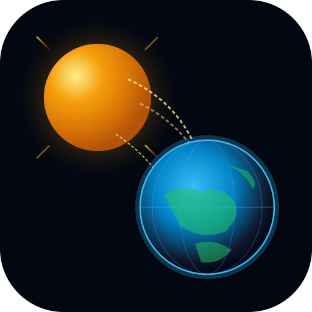

# ☀️ SOLAR EARTH — Observatoire Solaire, Mises à Jour Automatiques & Architecture Double-Mode

<div align="center">



### Mesure, Modélisation Radiative & Visualisation du Rayonnement Solaire sur Terre

[](https://github.com/sheriffhomard/SolarEarth/releases)
[](https://vite.dev/)
[](https://react.dev/)
[](https://www.typescriptlang.org/)
[](https://vitest.dev/)
[](https://web.dev/progressive-web-apps/)
[](https://tailwindcss.com/)
[_%26_SQLite_(Dev)-0ea5e9.svg)](https://developer.mozilla.org/fr/docs/Web/API/IndexedDB_API)
[](https://re.jrc.ec.europa.eu/pvg_tools/en/)

</div>

---

## 📸 Aperçu de l'Application

<div align="center">
  
</div>

---

## 🌟 Nouveautés de la Version v0.3.0

- ⚙️ **Menu de Paramètres Système Complet** :
  - **Date de sortie officielle** : affichage transparent de la version (`28 octobre 2026`).
  - **Date de la dernière vérification** : contrôle et horodatage de la dernière vérification des paquets et services.
  - **Bouton « Vérifier les mises à jour »** : interrogation en temps réel de l'API et du Service Worker.
  - **Bouton « Forcer la mise à jour »** : purge intégrale des caches `CacheStorage`, signal `SKIP_WAITING` et rechargement propre.
- 🔄 **Système de Mises à Jour Automatiques en Arrière-Plan** :
  - Cycle de surveillance automatique paramétrable (5, 15, 30 ou 60 minutes).
  - Détection automatique au retour de focus de l'application (`visibilitychange`).
  - Installation transparente en tâche de fond avec notification non intrusive à l'utilisateur.
- ☀️ / 🌙 **Thème Clair Intégral & Thème Sombre** :
  - Bascule instantanée entre le **Thème Sombre** (ambiance nocturne d'observatoire) et le **Thème Clair** (lecture haute luminosité en plein soleil).
  - Mode **Système Automatique** synchronisé avec les préférences de votre système d'exploitation.
- 📜 **Onboarding Guidé & Mentions Légales Formelles** :
  - Présentation pas-à-pas des fonctionnalités clés et principes physiques.
  - **Décharge de responsabilité formelle** : décharge explicite de l'auteur et de l'éditeur quant à l'exactitude des calculs et aux décisions techniques ou financières d'installations solaires.
  - Case à cocher obligatoire lors du premier démarrage (réouvrable à tout moment).
- 💡 **Onboarding Contextuel & Infobulles Interactives** :
  - Composant `InfoTooltip` sur chaque grandeur physique ($GHI$, $DNI$, $DHI$, $H_{sun}$, $AM$, $H_d$).
  - Formules mathématiques et normes internationales (Spencer 1971, Bird & Hulstrom 1981, WMO No. 8).
- 📲 **Bouton « Installer l'application » PWA** :
  - Détection immédiate du support de navigation (Chromium, Edge, Android, iOS).
  - Déclenchement automatique de l'installation sur smartphone et bureau.
  - Guide pas-à-pas illustré pour Safari iOS (*Partager* > *Sur l'écran d'accueil*).

---

## 🏛️ Architecture Double-Mode & Stockage Découplé

**Solar Earth** a été conçu pour éliminer toute dépendance obligatoire envers un serveur cloud ou un conteneur Docker lors de son utilisation sur smartphone :

```
┌─────────────────────────────────────────────────────────────────────────────┐
│                       SOLAR EARTH — DOUBLE MODE                             │
├──────────────────────────────────────┬──────────────────────────────────────┤
│ MODE 1 : PWA CLIENT 100% AUTONOME    │ MODE 2 : STATION DEV & INGESTION     │
│ (Navigateur Mobile / Smartphone)     │ (Serveur Local / Desktop / CI)       │
├──────────────────────────────────────┼──────────────────────────────────────┤
│ • Moteur d'exécution : Navigateur    │ • Moteur : Node.js (Vite) / Python   │
│ • Stockage : IndexedDB localisé      │ • Stockage : Fichier SQLite 3 local  │
│   (base SolarEarth_MobileDB)         │   (fichier local solar_earth.db)     │
│ • Physique : Spencer & Bird 1981     │ • Script d'init : init_sqlite.py     │
│   exécutés 100% en TypeScript client │ • Services : Express, FastAPI,       │
│ • Zéro conteneur Docker requis       │   Pytest, Ruff, scripts batch        │
│ • Zéro serveur externe obligatoire   │ • Traitement de gros rasters SIG     │
│ • Zéro port réseau TCP exposé        │ • Testé dans le job backend de la CI │
│ • Zéro substitution silencieuse      │ • Accès système de fichiers natif    │
└──────────────────────────────────────┴──────────────────────────────────────┘
```

### Clarification sur le stockage réel :
1. **Sur smartphone (PWA installée ou navigateur mobile)** : SQLite n'est pas ouvert dans le système de fichiers du téléphone. Le stockage opérationnel réel est **IndexedDB** (`SolarEarth_MobileDB`), intégré au navigateur dans son bac à sable sécurisé (*Same-Origin Policy*), 100% hors-ligne et sans port réseau.
2. **Sur ordinateur / serveur de développement** : La base **SQLite 3 (`solar_earth.db`)** est gérée par le runtime Node.js ou le backend Python. Ce fichier local est exclu de Git (`.gitignore`) et audité par `PRAGMA quick_check;`.

---

## 🛰️ Intégration PVGIS v5.3 & Rigueur Métrologique

### 1. Suppression Définitive de la Substitution Silencieuse
- L'archive officielle des observations satellitaires **PVGIS SARAH-3, SARAH-2 et ERA5** de la Commission Européenne couvre strictement les années documentées (2005 à 2023 pour SARAH-3).
- Les versions antérieures substituaient l'année 2020 pour toute date future ou passée. **Ce comportement trompeur a été entièrement supprimé**.
- Pour toute date postérieure ou antérieure à l'archive : l'application indique clairement `data_type: 'simulated_clearsky'`, active le repli explicite vers le modèle astronomique Spencer & Bird (1981), et renseigne `fallback_applied: true` avec la justification scientifique.

### 2. Préservation des Horodatages Sources
- Les minutes réelles UTC d'observation satellitaire (ex. `12:10` pour SARAH, `12:00` pour ERA5) sont strictement conservées dans les horodatages ISO 8601 (`YYYY-MM-DDTHH:MM:00Z`).

### 3. Calcul Physique du DNI & Réfraction Atmosphérique
Pour les faibles élévations solaires ($H_{sun} \le 1.0^\circ$), la formule de projection normale géométrique diverge. Solar Earth intègre la formule de réfraction atmosphérique de Bennett & Saemundsson :
$$R = \frac{1.02}{\tan\left(H_{sun} + \frac{10.3}{H_{sun} + 5.11}\right) \times 60} \quad (\text{en degrés})$$
Aux angles rasants, le DNI est dérivé sur la hauteur apparente $H_{app} = H_{sun} + R$ et plafonné à la constante solaire extraterrestre $I_0 = 1361.2 \text{ W/m}^2$. De nuit ($H_{sun} \le 0^\circ$), $GHI = 0$, $DNI = 0$, $DHI = 0$.

### 4. Validation Horaire Stricte & Cas Polaires
- Expression régulière stricte `/^\d{8}:\d{4}$/`.
- Vérification chronologique sans doublons et validation de la présence des 24 heures (0..23).
- Rejet immédiat de toute valeur manquante sans remplacement artificiel par zéro.
- Support physique des régimes polaires : 24h de jour permanent ($H_{sun} > 0^\circ$) et 24h de nuit permanente ($H_{sun} \le 0^\circ$).

---

## 📊 Modules Applicatifs Disponibles

| Module | Description | Moteur & Données |
| :--- | :--- | :--- |
| **Dashboard** | Vue synthétique du cycle journalier 24h, KPI solaires et infobulles | Modèle hybride PVGIS v5.3 / Spencer & Bird |
| **World Map** | Carte mondiale avec stations de référence et exploration géographique | IndexedDB & projections géodésiques |
| **Simulateur PV** | Dimensionnement photovoltaïque avec orientation, inclinaison et pertes | Modèle Perez & coefficient thermique |
| **Trajectoire Solaire** | Diagramme polaire d'élévation et d'azimut solaire au cours de l'année | Équation du temps NOAA & Spencer |
| **Historique** | Archivage local des stations personnalisées et calculs radiatifs | IndexedDB Mobile / SQLite 3 Dev |
| **Laboratoire & Audit** | Audit de clôture radiative ($GHI = DNI \sin\alpha + DHI$) et conformité CI | Moteur de validation métrologique |
| **Paramètres Système** | Gestion des versions, mises à jour automatiques, thèmes et mentions légales | Service Worker & `UpdateService` |

---

## ⚡ Démarrage Rapide

### Prérequis
- **Node.js** : version 22+ (recommandée)
- **Navigateur** : Chrome, Firefox, Safari ou Edge récent

### Installation & Lancement en Développement
```bash
# Cloner le dépôt
git clone https://github.com/sheriffhomard/SolarEarth.git
cd SolarEarth

# Installer les dépendances
npm install

# Démarrer le serveur de développement (port 3000)
npm run dev
```

### Exécution des Tests Automatisés
```bash
# Lancer les 52 tests unitaires et d'intégration Vitest
npm run test:run

# Vérification du typage TypeScript
npm run typecheck
```

### Compilation de Production & Démarrage Full-Stack
```bash
# Générer le bundle de production PWA
npm run build

# Démarrer le serveur de production Express
npm start
```

---

## 🔒 Sécurité & Protection des Données

- **Zéro Port Réseau Ouvert** : aucun port de base de données (TCP 5432 / 3306) n'est exposé.
- **Stockage Local Sécurisé** : les données sont hébergées dans le bac à sable IndexedDB de l'appareil client selon la politique *Same-Origin*.
- **Validation Stricte des Entrées** : latitudes bornées dans $[-90^\circ, +90^\circ]$, longitudes dans $[-180^\circ, +180^\circ]$, dates au format ISO (1980–2060).
- **Zéro Clé API Exposée** : PVGIS est interrogé via des endpoints ouverts sans secret applicatif dans le bundle frontend.

---

## 📄 Licence & Mentions Légales

Ce projet est distribué sous licence MIT.

**Avertissement de non-responsabilité** : Les données, prévisions et calculs de rayonnement solaire fournis par Solar Earth sont délivrés à titre purement indicatif et de recherche scientifique. L'auteur et l'éditeur déclinent expressément toute responsabilité quant à l'exactitude des valeurs fournies ou aux décisions techniques, financières ou d'ingénierie prises sur la base de ces simulations.
